# Entropia congiunta

Come cambia l’accuratezza di NJEE rispetto a plug-in e Miller–Madow quando crescono la dimensione dell’alfabeto congiunto e la numerosità del campione? Lo studio usa vettori di Bernoulli indipendenti e catene binarie.

Il manifest finale registra **27 scenari** e **4.050 record completati**.
Le quantità di informazione e i relativi errori sono espressi in nat.

[Esecuzione dello studio](../../experiments/final_validation.py) · [Protocollo](../../experiments/final_protocol.py) · [Generazione delle figure](../../src/reporting/figures.py) · [Esportazione delle tabelle](../../src/reporting/tables.py)

[Scarica figure e tabelle complete (ZIP)](https://github.com/vdb1099-gif/njee-thesis/releases/download/thesis-results-v1/entropy-results.zip).

## Tabelle

La campagna usa d = 4, 8, 12 e n = 200, 800, 3.200. Le tre numerosità sono disponibili per la catena con ε = 0,15 e per Bernoulli indipendenti con p = 0,50. Gli altri parametri compaiono a n = 800.

Per la catena con ε = 0,15 e d = 4, l’RMSE scende con n per tutti gli stimatori mostrati. A n = 800, NJEE passa da circa 0,081 nat a d = 4 a 0,189 nat a d = 12. A d = 12, plug-in e Miller–Madow sul campione intero hanno RMSE di circa 0,520 e 0,352 nat.

Ogni scenario comprende 30 repliche. Le varianti `full` usano il campione completo e le varianti `train` usano il sottoinsieme di addestramento. I grafici dei tempi riportano le medie al variare di n.

- [Riepiloghi per scenario e stimatore (RMSE, bias, deviazione standard e numerosità)](tables/summaries.csv)
- [Tempi e costi per replica](tables/costs.csv)
- [Confronti appaiati](tables/paired_comparisons.csv)
- [Confronti confermativi](tables/confirmatory.csv)
- [Intervalli di incertezza](tables/uncertainty.csv)

## Figure

La galleria mostra una selezione per tipo di grafico. L’[indice completo](figure-catalog.md) elenca tutti i 94 grafici, con i parametri fissati e i CSV di origine.

### Bias rispetto alla numerosità

**d = 12, generatore = binary_chain, parametro = 0.15**

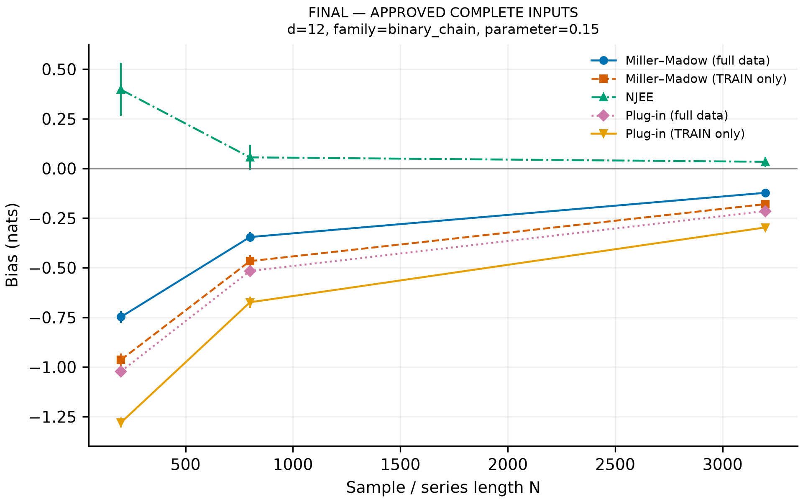

[CSV dei punti del grafico](tables/bias-nats-sample-size--d-12--family-binary-chain--parameter-0-15-points.csv) · [Tabella di origine](tables/summaries.csv).

**d = 4, generatore = binary_chain, parametro = 0.15**

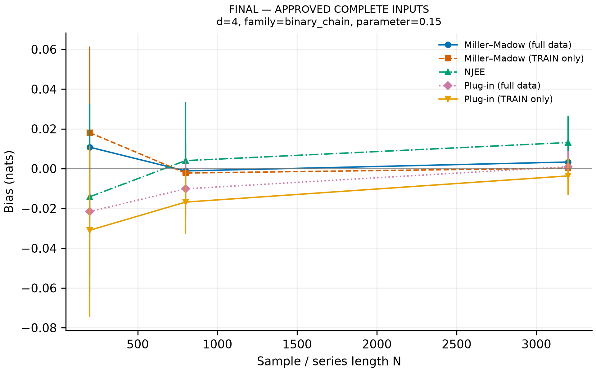

[CSV dei punti del grafico](tables/bias-nats-sample-size--d-4--family-binary-chain--parameter-0-15-points.csv) · [Tabella di origine](tables/summaries.csv).

### RMSE rispetto alla numerosità

**d = 12, generatore = binary_chain, parametro = 0.15**

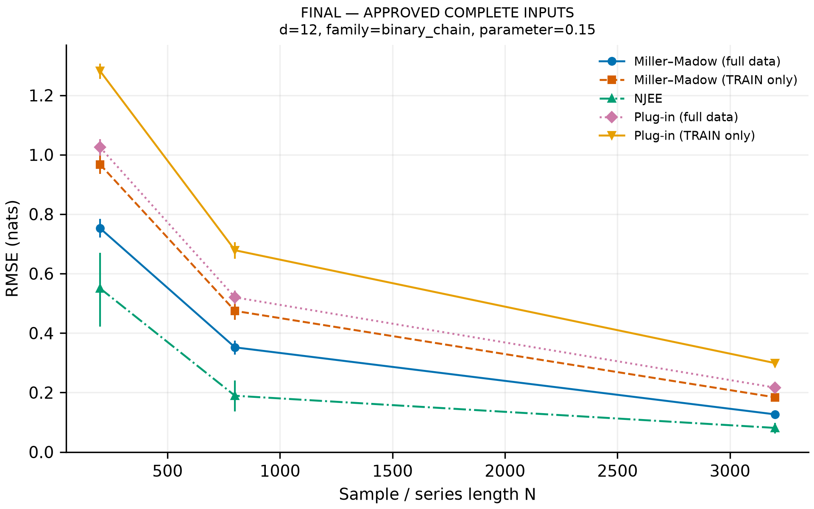

[CSV dei punti del grafico](tables/rmse-nats-sample-size--d-12--family-binary-chain--parameter-0-15-points.csv) · [Tabella di origine](tables/summaries.csv).

**d = 4, generatore = binary_chain, parametro = 0.15**

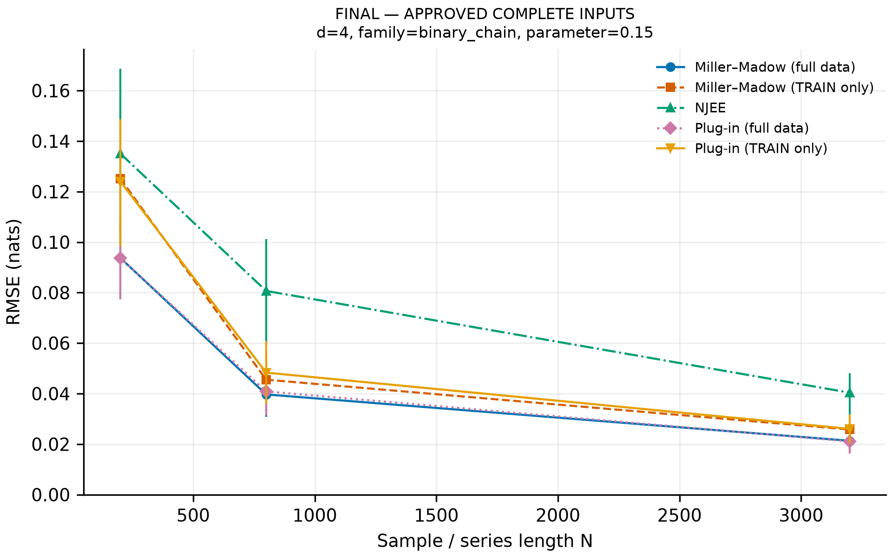

[CSV dei punti del grafico](tables/rmse-nats-sample-size--d-4--family-binary-chain--parameter-0-15-points.csv) · [Tabella di origine](tables/summaries.csv).

### RMSE rispetto alla dimensione

**generatore = binary_chain, n = 800, parametro = 0.15**

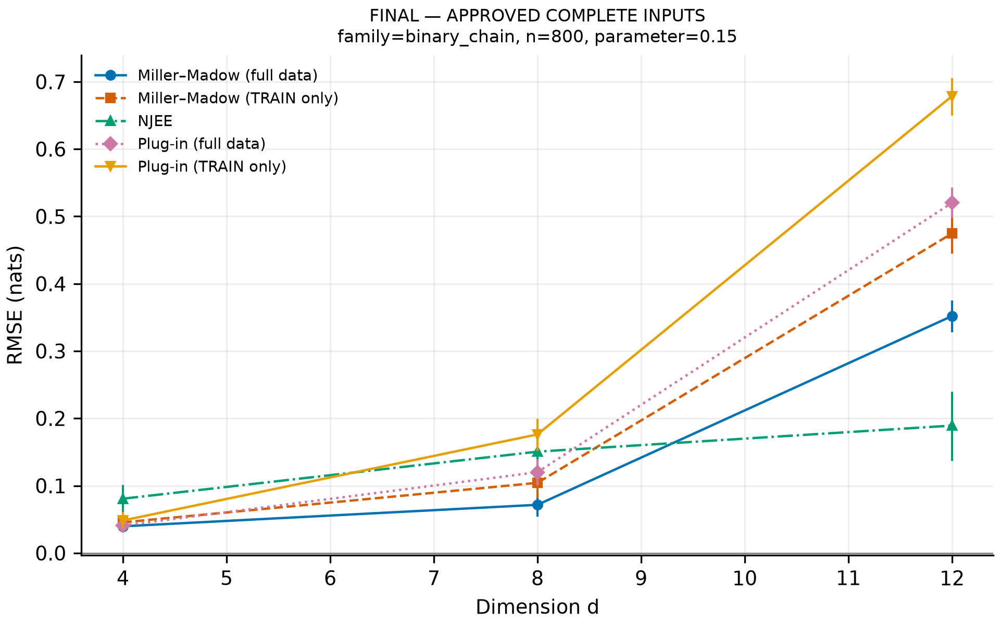

[CSV dei punti del grafico](tables/rmse-dimensionality--family-binary-chain--n-800--parameter-0-15-points.csv) · [Tabella di origine](tables/summaries.csv).

### Tempo medio rispetto alla numerosità

**d = 12, generatore = binary_chain, parametro = 0.15**

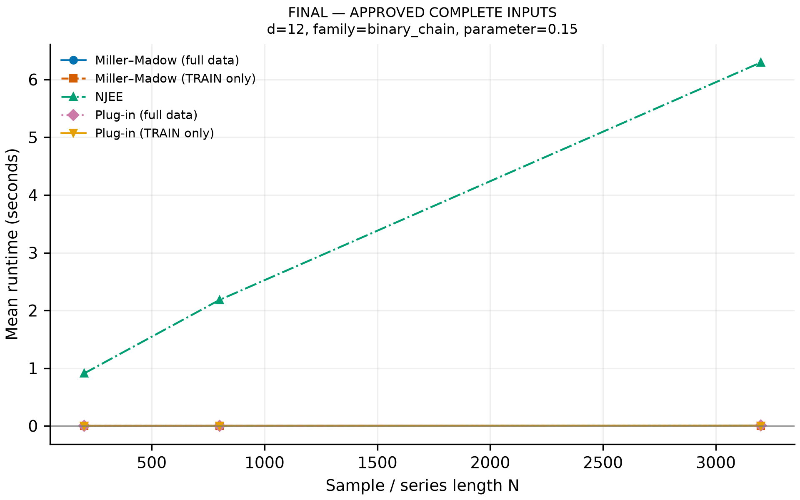

[CSV dei punti del grafico](tables/runtime-sample-size--d-12--family-binary-chain--parameter-0-15-points.csv) · [Tabella di origine](tables/summaries.csv).

**d = 4, generatore = binary_chain, parametro = 0.15**

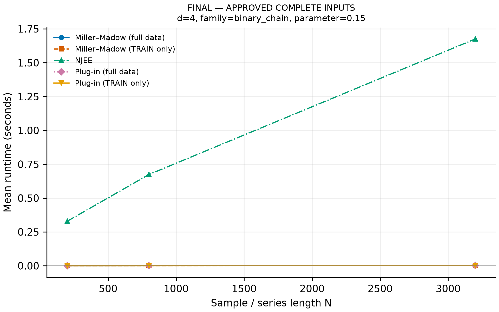

[CSV dei punti del grafico](tables/runtime-sample-size--d-4--family-binary-chain--parameter-0-15-points.csv) · [Tabella di origine](tables/summaries.csv).

### RMSE per generatore

**d = 4, n = 800**

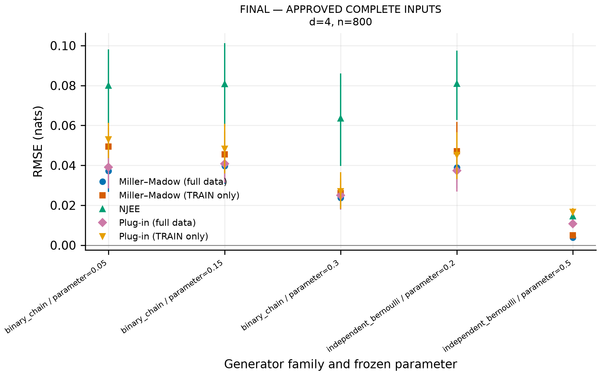

[CSV dei punti del grafico](tables/generator-family-comparison--d-4--n-800-points.csv) · [Tabella di origine](tables/summaries.csv).

### Confronti appaiati con correzione di Bonferroni

**scenario = F01**

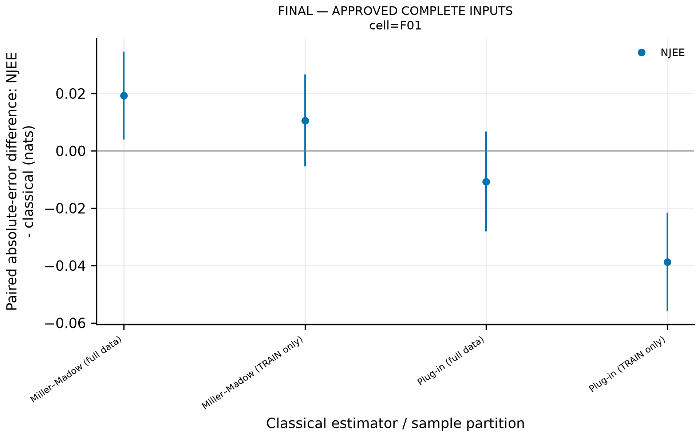

[CSV dei punti del grafico](tables/confirmatory-adjusted--cell-f01-points.csv) · [Tabella di origine](tables/confirmatory.csv).

**scenario = F17**

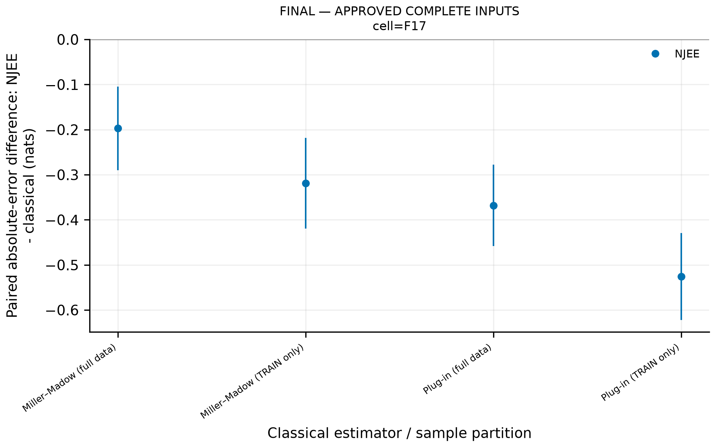

[CSV dei punti del grafico](tables/confirmatory-adjusted--cell-f17-points.csv) · [Tabella di origine](tables/confirmatory.csv).

### Cross-entropy di validazione per termine

**scenario = F11-chain-e015-d04-n00800, componente = joint**

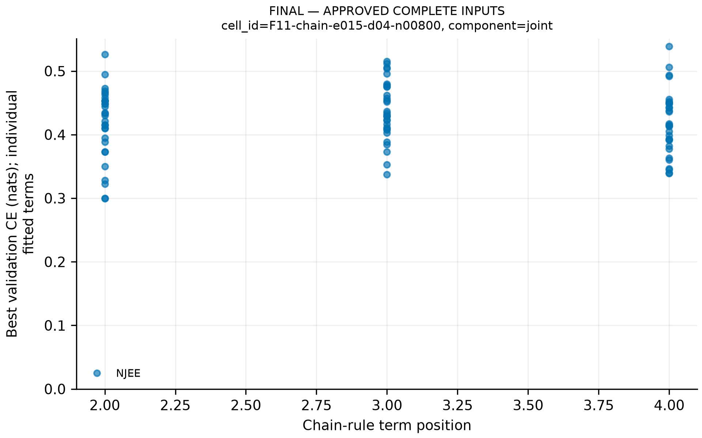

[CSV dei punti del grafico](tables/conditional-term-validation--cell-id-f11-chain-e015-d04-n00800--component-joint-points.csv) · Tabella di origine: `tables/terms.csv` nel pacchetto.
