# Informazione mutua e condizionale

Con quale accuratezza si stimano MI e CMI, e quanto spesso si conclude che esiste una dipendenza nei casi nulli? Lo studio usa generatori sintetici con valori di riferimento noti.

Il manifest finale registra **85 scenari** e **21.250 record completati**.
Le quantità di informazione e i relativi errori sono espressi in nat.

[Esecuzione dello studio](../../experiments/information_validation.py) · [Protocollo](../../experiments/information_protocol.py) · [Generazione delle figure](../../src/reporting/figures.py) · [Esportazione delle tabelle](../../src/reporting/tables.py)

Il protocollo usa 50 repliche per scenario e cinque numerosità da 250 a 10.000. Le figure distinguono MI e CMI, e il test sotto il nullo è riportato separatamente dalle misure di accuratezza delle stime.

Nel caso nullo MI con canale binario e εY = 0,50, il tasso empirico di falsi positivi varia dal 2% all’8% fra le cinque numerosità. Per leggere questi valori insieme ai denominatori e agli intervalli, si può aprire la [tabella delle decisioni](tables/accuracy.csv).

[Scarica figure e tabelle complete (ZIP)](https://github.com/vdb1099-gif/njee-thesis/releases/download/thesis-results-v1/information-results.zip).

## Tabelle

- [Riepiloghi per scenario e stimatore (RMSE, bias, deviazione standard e numerosità)](tables/summaries.csv)
- [Accuratezza e frequenze delle decisioni](tables/accuracy.csv)
- [Confronti appaiati](tables/paired_comparisons.csv)
- [Intervalli di incertezza](tables/uncertainty.csv)
- [Correlazioni degli errori](tables/correlations.csv)

## Figure

La galleria mostra una selezione per tipo di grafico. L’[indice completo](figure-catalog.md) elenca tutti i 388 grafici, con i parametri fissati e i CSV di origine.

### Stima media con segno

**εX = 0.0, εY = 0.0, generatore = bsc, quantità = MI**

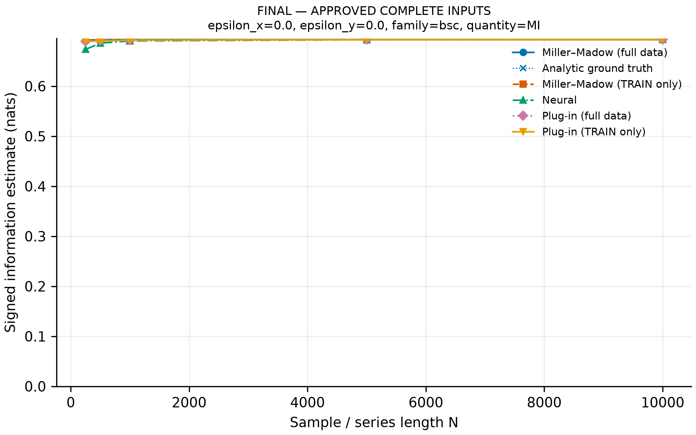

[CSV dei punti del grafico](tables/mean-estimate-nats-sample-size--epsilon-x-0-0--epsilon-y-0-0--family-bsc--quantity-mi-points.csv) · [Tabella di origine](tables/summaries.csv).

**εX = 0.15, εY = 0.0, generatore = chain, quantità = CMI**

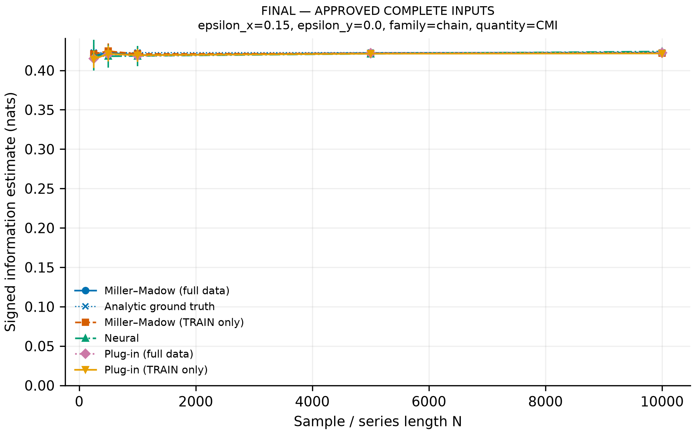

[CSV dei punti del grafico](tables/mean-estimate-nats-sample-size--epsilon-x-0-15--epsilon-y-0-0--family-chain--quantity-cmi-points.csv) · [Tabella di origine](tables/summaries.csv).

### Bias rispetto alla numerosità

**εX = 0.0, εY = 0.0, generatore = bsc, quantità = MI**

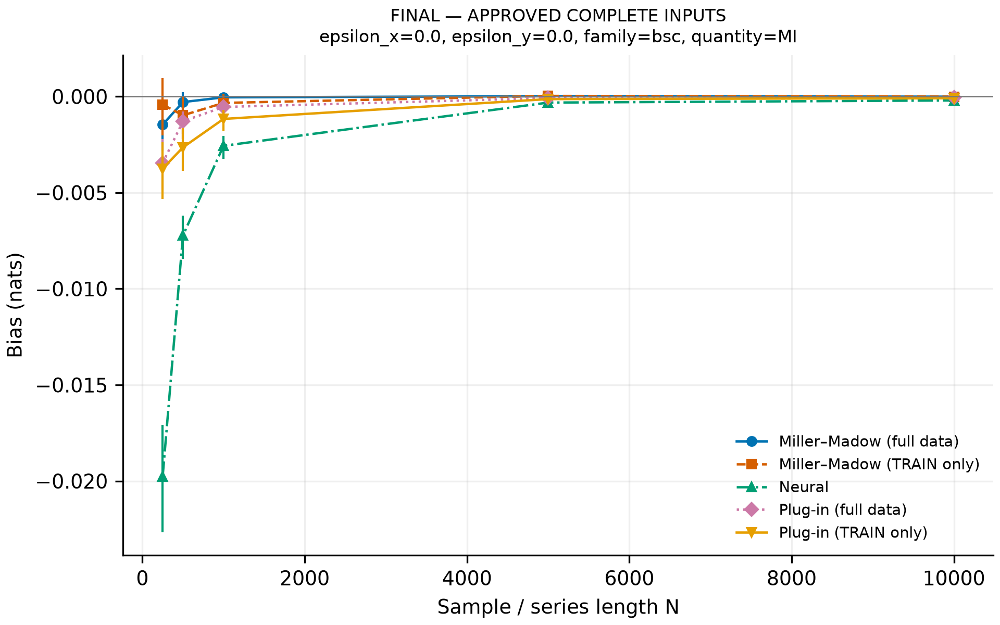

[CSV dei punti del grafico](tables/bias-nats-sample-size--epsilon-x-0-0--epsilon-y-0-0--family-bsc--quantity-mi-points.csv) · [Tabella di origine](tables/summaries.csv).

**εX = 0.15, εY = 0.0, generatore = chain, quantità = CMI**

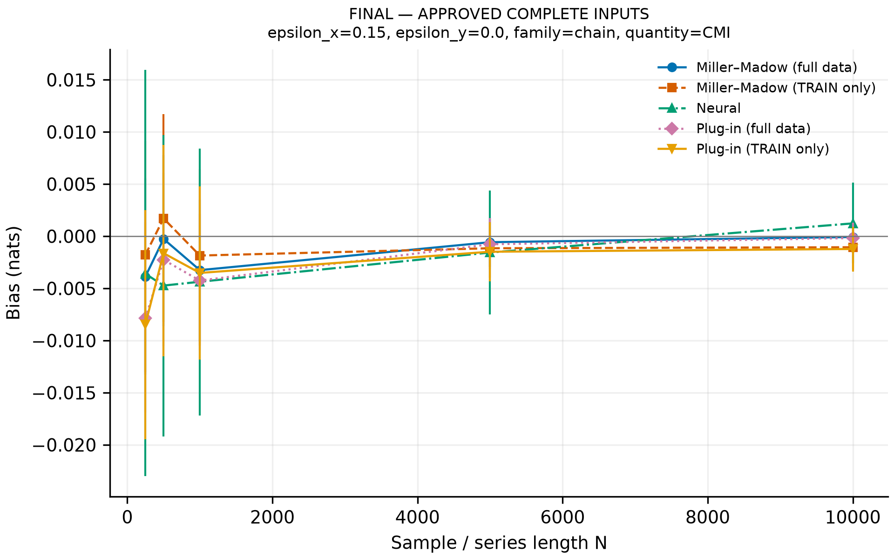

[CSV dei punti del grafico](tables/bias-nats-sample-size--epsilon-x-0-15--epsilon-y-0-0--family-chain--quantity-cmi-points.csv) · [Tabella di origine](tables/summaries.csv).

### RMSE rispetto alla numerosità

**εX = 0.0, εY = 0.0, generatore = bsc, quantità = MI**

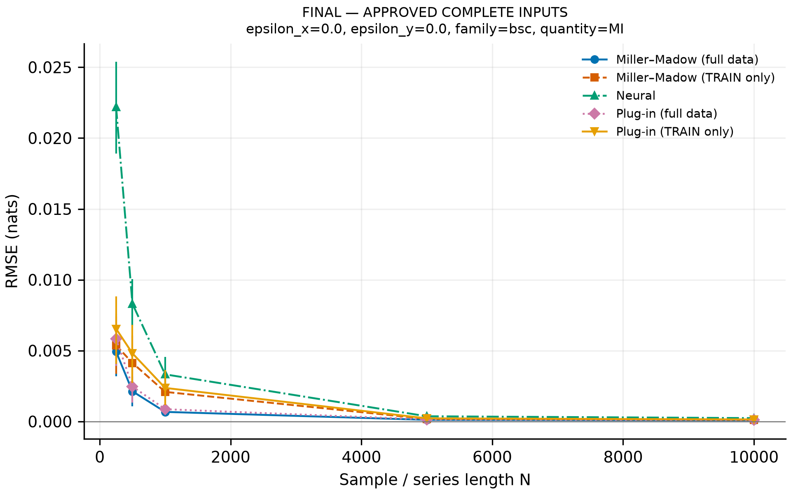

[CSV dei punti del grafico](tables/rmse-nats-sample-size--epsilon-x-0-0--epsilon-y-0-0--family-bsc--quantity-mi-points.csv) · [Tabella di origine](tables/summaries.csv).

**εX = 0.15, εY = 0.0, generatore = chain, quantità = CMI**

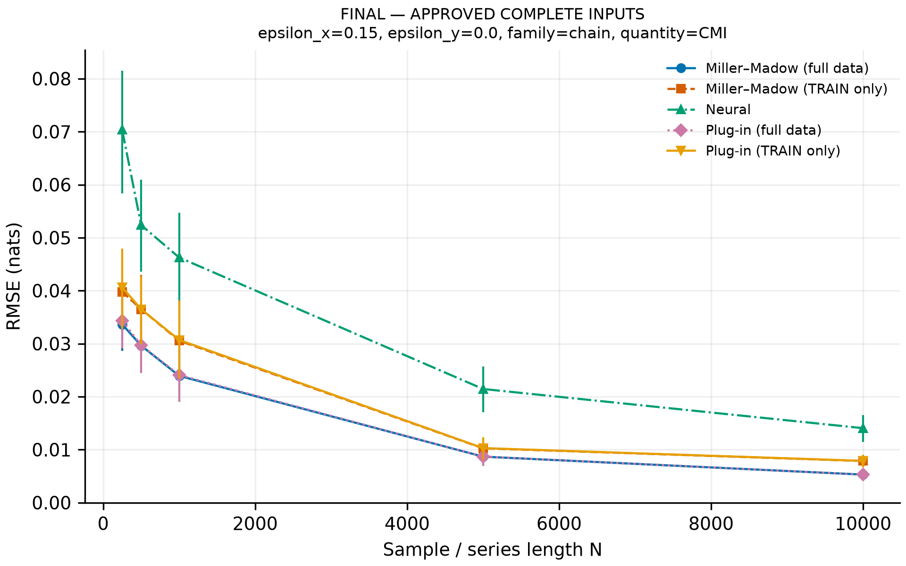

[CSV dei punti del grafico](tables/rmse-nats-sample-size--epsilon-x-0-15--epsilon-y-0-0--family-chain--quantity-cmi-points.csv) · [Tabella di origine](tables/summaries.csv).

### Errore assoluto medio

**εX = 0.0, εY = 0.0, generatore = bsc, quantità = MI**

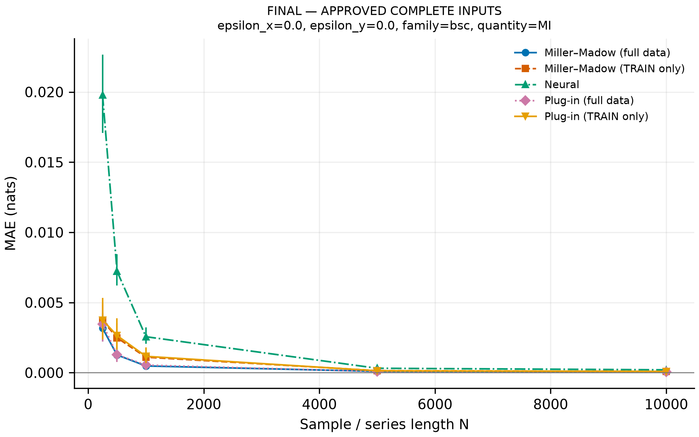

[CSV dei punti del grafico](tables/mae-nats-sample-size--epsilon-x-0-0--epsilon-y-0-0--family-bsc--quantity-mi-points.csv) · [Tabella di origine](tables/summaries.csv).

**εX = 0.15, εY = 0.0, generatore = chain, quantità = CMI**

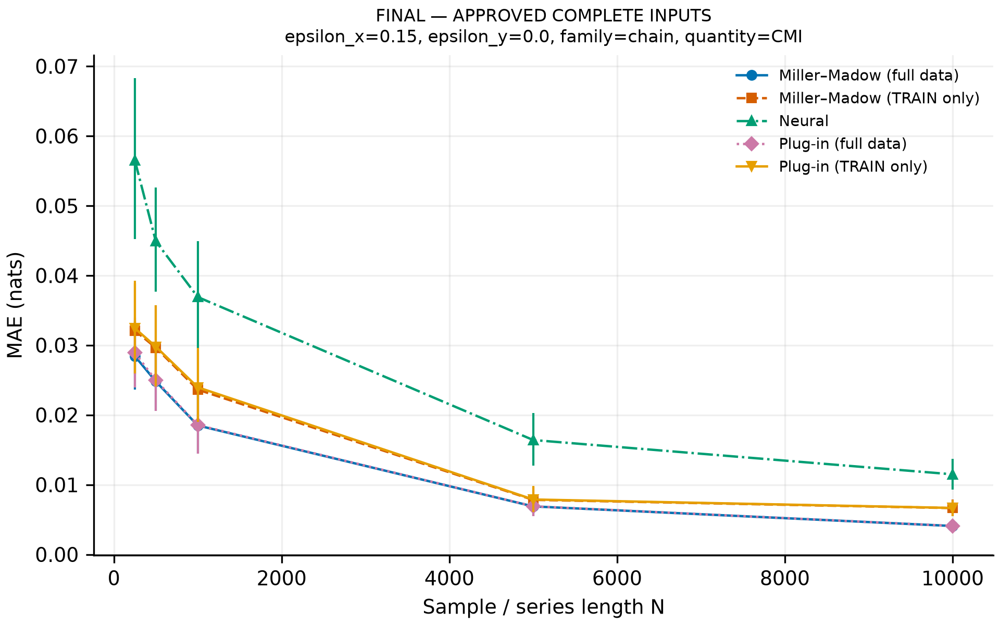

[CSV dei punti del grafico](tables/mae-nats-sample-size--epsilon-x-0-15--epsilon-y-0-0--family-chain--quantity-cmi-points.csv) · [Tabella di origine](tables/summaries.csv).

### Deviazione standard campionaria

**εX = 0.0, εY = 0.0, generatore = bsc, quantità = MI**

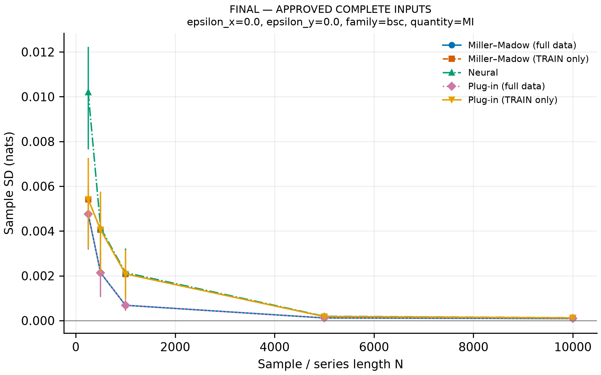

[CSV dei punti del grafico](tables/sample-std-nats-sample-size--epsilon-x-0-0--epsilon-y-0-0--family-bsc--quantity-mi-points.csv) · [Tabella di origine](tables/summaries.csv).

**εX = 0.15, εY = 0.0, generatore = chain, quantità = CMI**

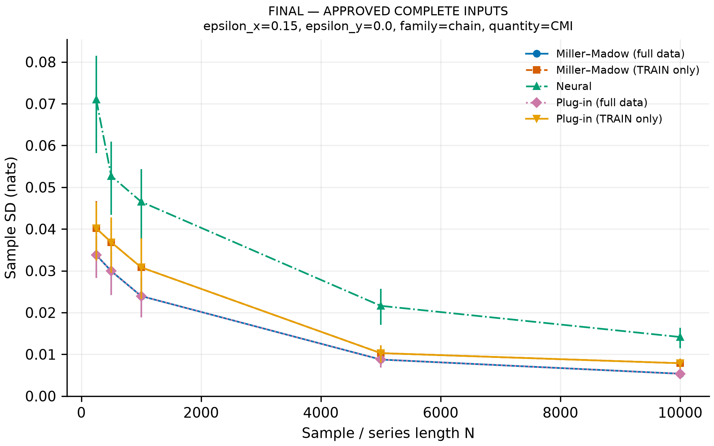

[CSV dei punti del grafico](tables/sample-std-nats-sample-size--epsilon-x-0-15--epsilon-y-0-0--family-chain--quantity-cmi-points.csv) · [Tabella di origine](tables/summaries.csv).

### Frequenza delle stime negative

**εX = 0.0, εY = 0.0, generatore = bsc, quantità = MI**

[CSV dei punti del grafico](tables/negative-frequency--epsilon-x-0-0--epsilon-y-0-0--family-bsc--quantity-mi-points.csv) · [Tabella di origine](tables/accuracy.csv).

**εX = 0.15, εY = 0.0, generatore = chain, quantità = CMI**

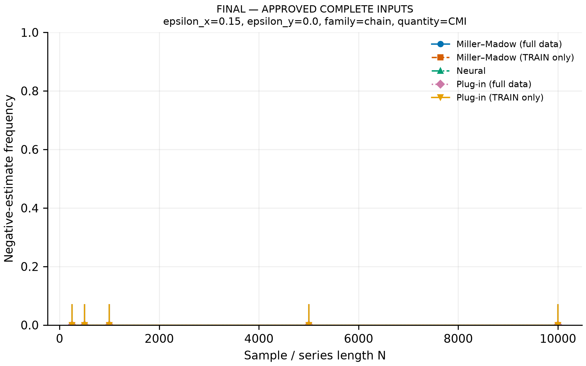

[CSV dei punti del grafico](tables/negative-frequency--epsilon-x-0-15--epsilon-y-0-0--family-chain--quantity-cmi-points.csv) · [Tabella di origine](tables/accuracy.csv).

### Errori delle due componenti entropiche

**scenario = I001-bsc-ex000-ey000-n00250**

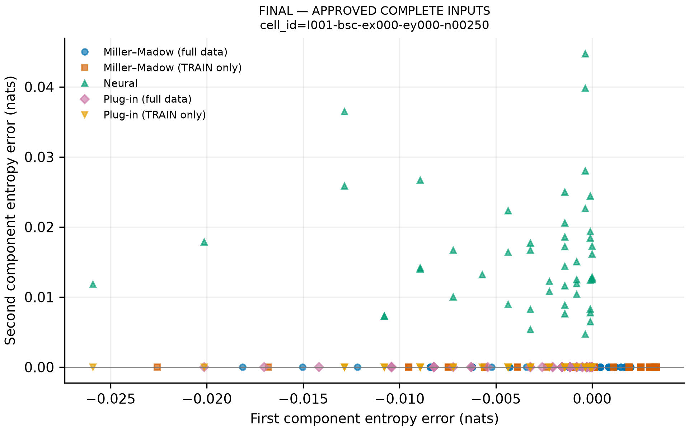

[CSV dei punti del grafico](tables/component-errors--cell-id-i001-bsc-ex000-ey000-n00250-points.csv) · Tabella di origine: `tables/components.csv` nel pacchetto.

### Correlazione tra gli errori delle componenti

**εX = 0.0, εY = 0.0, generatore = bsc, quantità = MI**

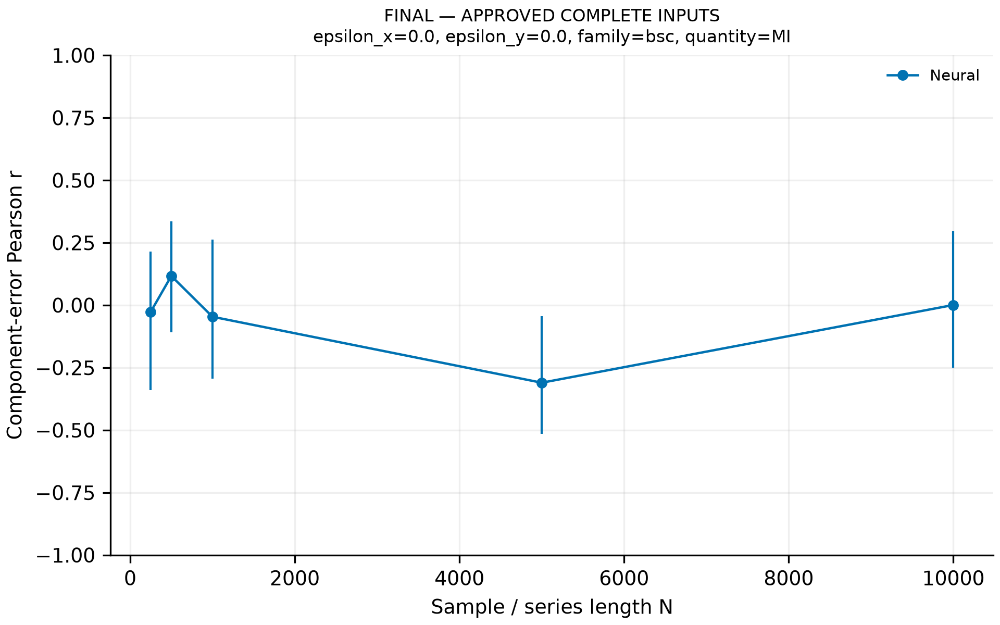

[CSV dei punti del grafico](tables/component-error-correlation--epsilon-x-0-0--epsilon-y-0-0--family-bsc--quantity-mi-points.csv) · [Tabella di origine](tables/correlations.csv).

**εX = 0.15, εY = 0.0, generatore = chain, quantità = CMI**

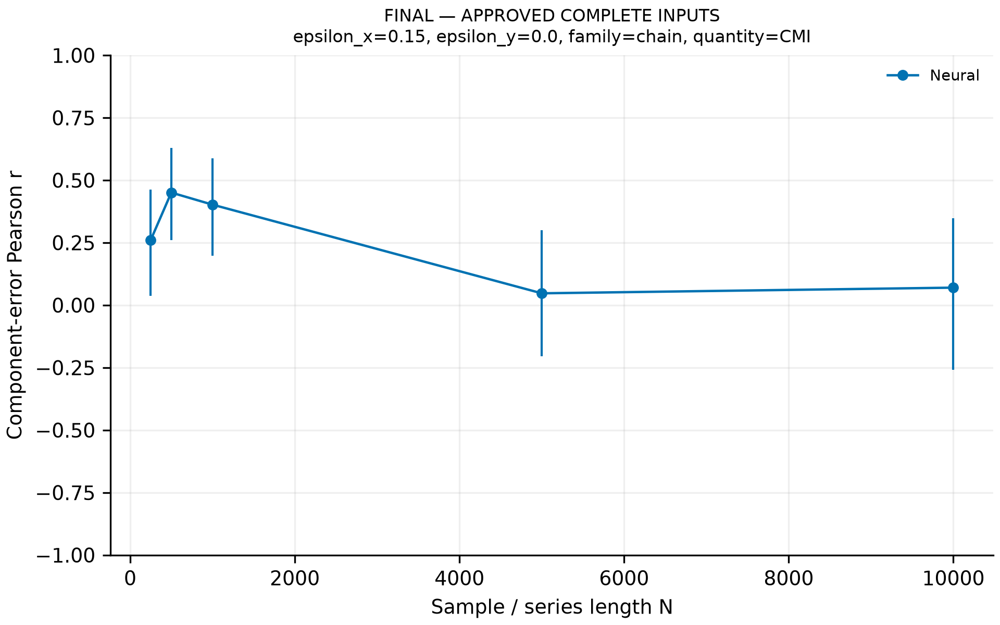

[CSV dei punti del grafico](tables/component-error-correlation--epsilon-x-0-15--epsilon-y-0-0--family-chain--quantity-cmi-points.csv) · [Tabella di origine](tables/correlations.csv).

### Falsi positivi nei casi nulli

**εX = 0.0, εY = 0.5, generatore = bsc, quantità = MI**

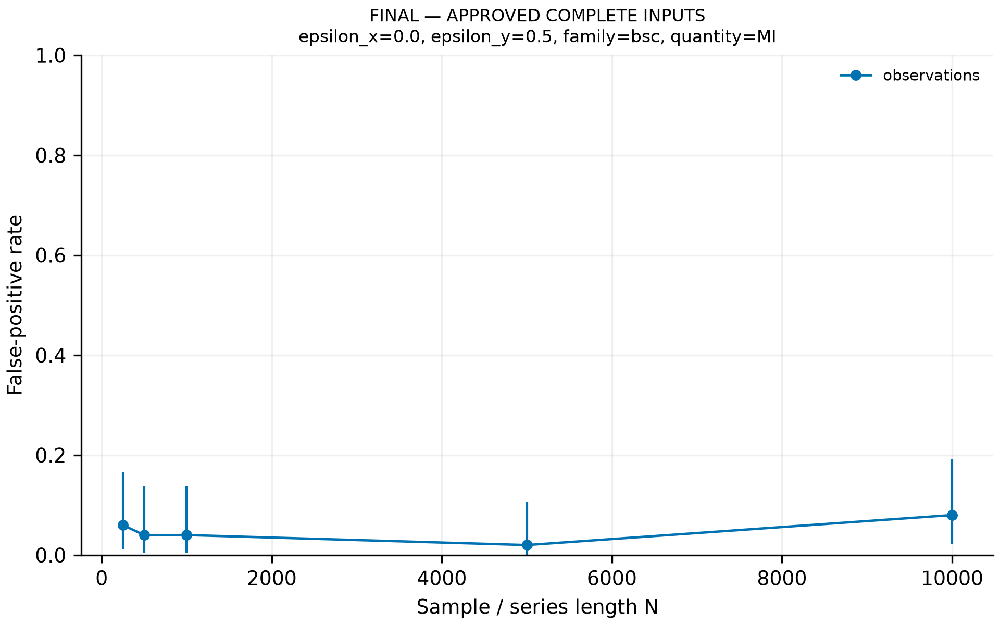

[CSV dei punti del grafico](tables/null-false-positive-rate--epsilon-x-0-0--epsilon-y-0-5--family-bsc--quantity-mi-points.csv) · [Tabella di origine](tables/accuracy.csv).

**εX = 0.15, εY = 0.15, generatore = fork, quantità = CMI**

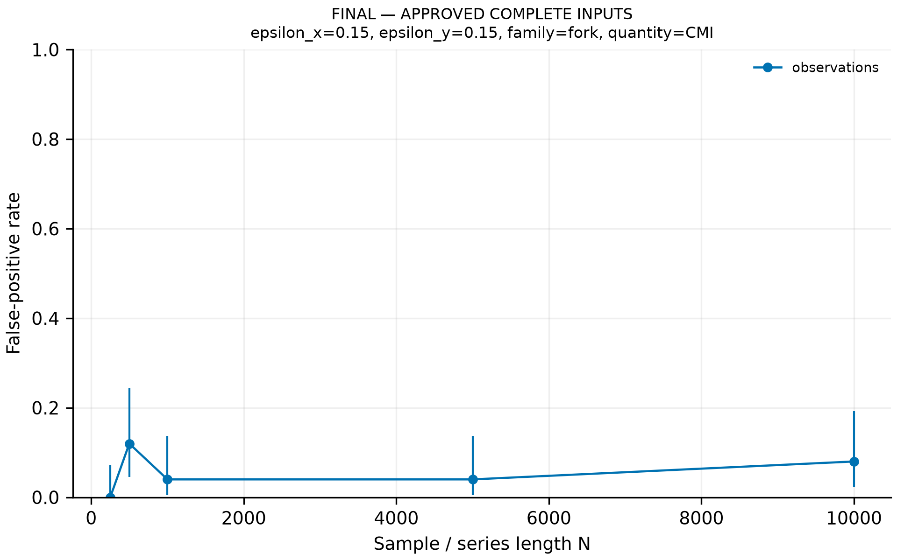

[CSV dei punti del grafico](tables/null-false-positive-rate--epsilon-x-0-15--epsilon-y-0-15--family-fork--quantity-cmi-points.csv) · [Tabella di origine](tables/accuracy.csv).

### Differenza appaiata di errore assoluto

**εX = 0.0, εY = 0.0, generatore = bsc, quantità = MI**

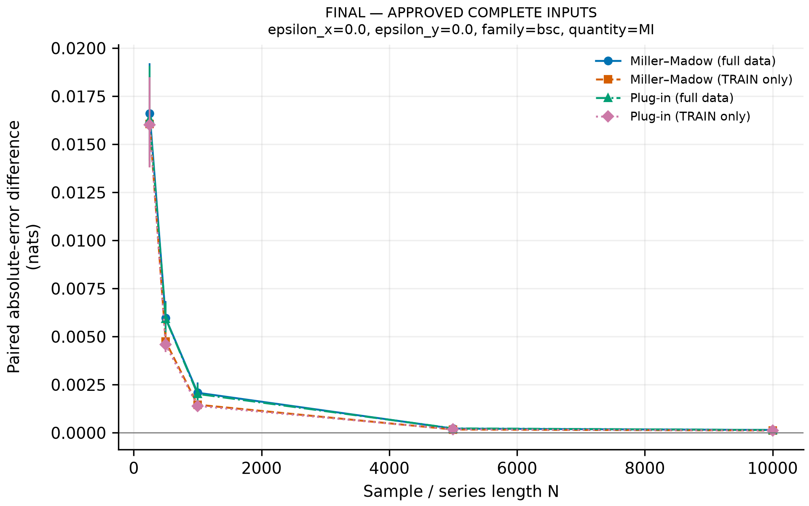

[CSV dei punti del grafico](tables/paired-absolute-error--epsilon-x-0-0--epsilon-y-0-0--family-bsc--quantity-mi-points.csv) · [Tabella di origine](tables/paired_comparisons.csv).

**εX = 0.15, εY = 0.0, generatore = chain, quantità = CMI**

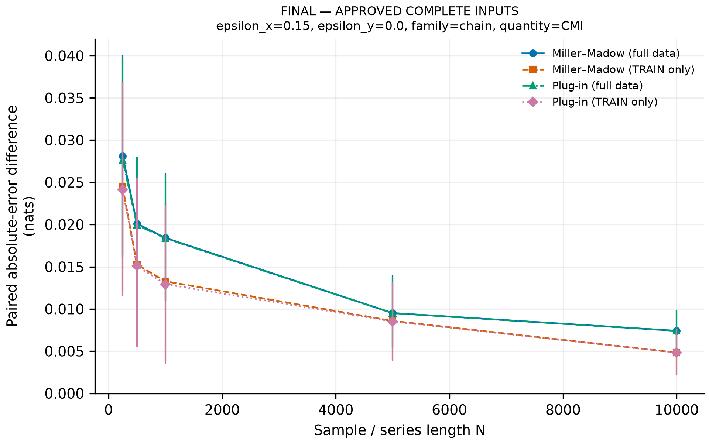

[CSV dei punti del grafico](tables/paired-absolute-error--epsilon-x-0-15--epsilon-y-0-0--family-chain--quantity-cmi-points.csv) · [Tabella di origine](tables/paired_comparisons.csv).

### Tempo medio rispetto alla numerosità

**εX = 0.0, εY = 0.0, generatore = bsc, quantità = MI**

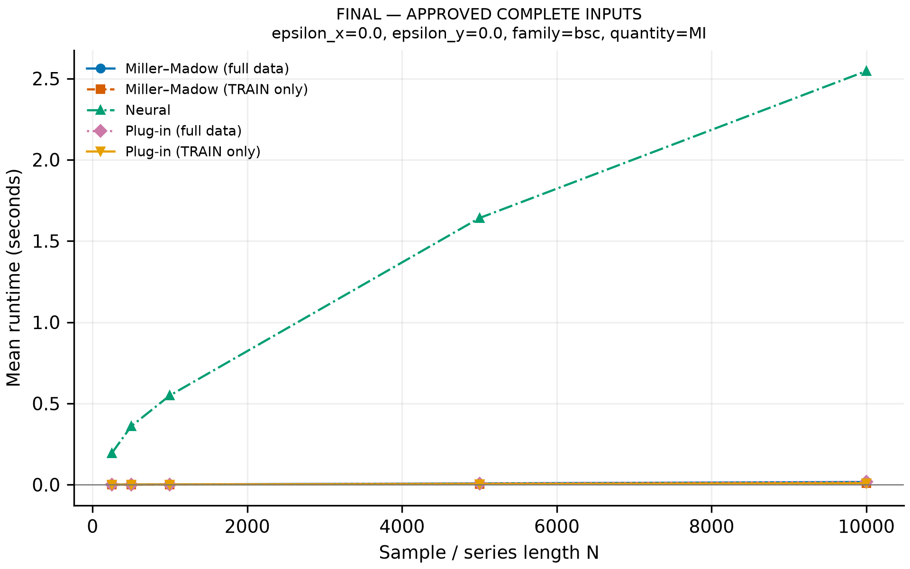

[CSV dei punti del grafico](tables/runtime-sample-size--epsilon-x-0-0--epsilon-y-0-0--family-bsc--quantity-mi-points.csv) · [Tabella di origine](tables/summaries.csv).

**εX = 0.15, εY = 0.0, generatore = chain, quantità = CMI**

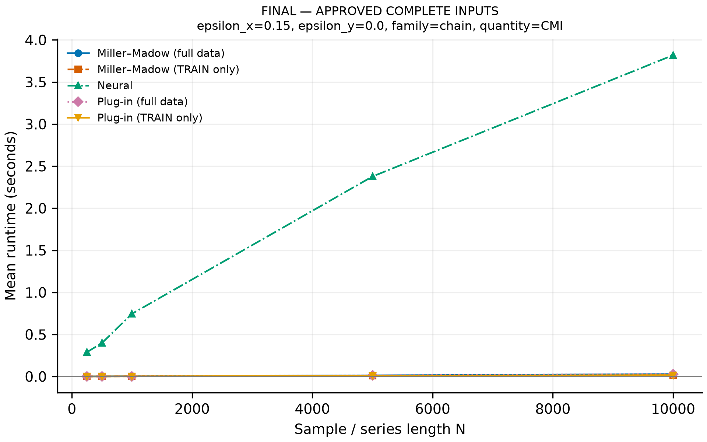

[CSV dei punti del grafico](tables/runtime-sample-size--epsilon-x-0-15--epsilon-y-0-0--family-chain--quantity-cmi-points.csv) · [Tabella di origine](tables/summaries.csv).

### Cross-entropy di validazione per termine

**scenario = I001-bsc-ex000-ey000-n00250, componente = h_x_given_y**

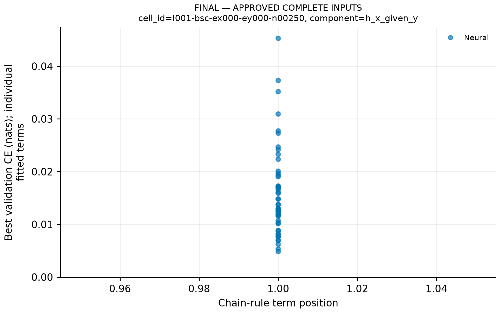

[CSV dei punti del grafico](tables/conditional-term-validation--cell-id-i001-bsc-ex000-ey000-n00250--component-h-x-given-y-points.csv) · Tabella di origine: `tables/terms.csv` nel pacchetto.
