# Transfer Entropy

Come cambiano le stime di TE, la direzione identificata e il ritardo selezionato al variare di numerosità, accoppiamento, ritardo fisico e storia inclusa nell’embedding? Le stime di TE sono confrontate con il riferimento per la storia finita corrispondente.

Il manifest finale registra **51 scenari** e **30.600 record completati**.
Le quantità di informazione e i relativi errori sono espressi in nat.

[Esecuzione dello studio](../../experiments/transfer_validation.py) · [Protocollo](../../experiments/transfer_protocol.py) · [Generazione delle figure](../../src/reporting/figures.py) · [Esportazione delle tabelle](../../src/reporting/tables.py)

Il protocollo usa 50 repliche per scenario e serie di 1.000, 5.000 o 10.000 osservazioni. Il ritardo fisico è impostato nel generatore. Il lag indicato nei grafici delle stime è quello usato dallo stimatore.

Con accoppiamento 0,30 e ritardo fisico 1, a n = 1.000 la direzione è identificata correttamente nel 98% delle repliche e il lag nel 86%. Nello stesso scenario entrambi i tassi raggiungono il 100% a n = 5.000 e n = 10.000. I tassi e i denominatori sono nella [tabella delle decisioni](tables/accuracy.csv).

[Scarica figure e tabelle complete (ZIP)](https://github.com/vdb1099-gif/njee-thesis/releases/download/thesis-results-v1/transfer-entropy-results.zip).

## Tabelle

- [Riepiloghi per scenario e stimatore (RMSE, bias, deviazione standard e numerosità)](tables/summaries.csv)
- [Accuratezza e frequenze delle decisioni](tables/accuracy.csv)
- [Confronti appaiati](tables/paired_comparisons.csv)
- [Intervalli di incertezza](tables/uncertainty.csv)
- [Valori di riferimento](tables/references.csv)

## Figure

La galleria mostra una selezione per tipo di grafico. L’[indice completo](figure-catalog.md) elenca tutti i 977 grafici, con i parametri fissati e i CSV di origine.

### TE nelle due direzioni rispetto a numerosità

**accoppiamento = 0.3, ritardo fisico = 1, embedding = canonical, lag = 1**

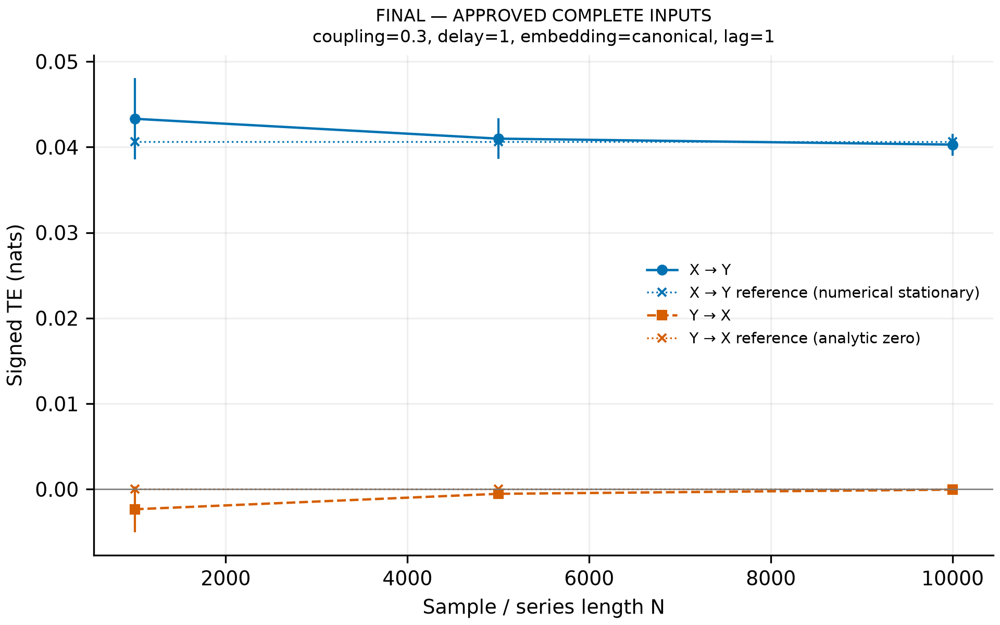

[CSV dei punti del grafico](tables/directional-te-n--coupling-0-3--delay-1--embedding-canonical--lag-1-points.csv) · [Tabella di origine](tables/summaries.csv).

### Differenza di TE tra direzioni rispetto a numerosità

**accoppiamento = 0.3, ritardo fisico = 1**

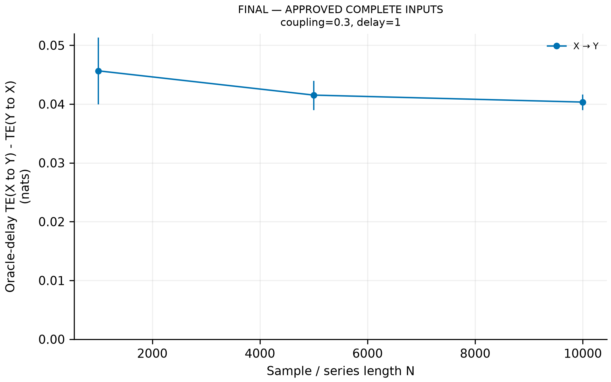

[CSV dei punti del grafico](tables/direction-difference-n--coupling-0-3--delay-1-points.csv) · [Tabella di origine](tables/paired_comparisons.csv).

### Accuratezza della direzione rispetto a numerosità

**accoppiamento = 0.3, ritardo fisico = 1**

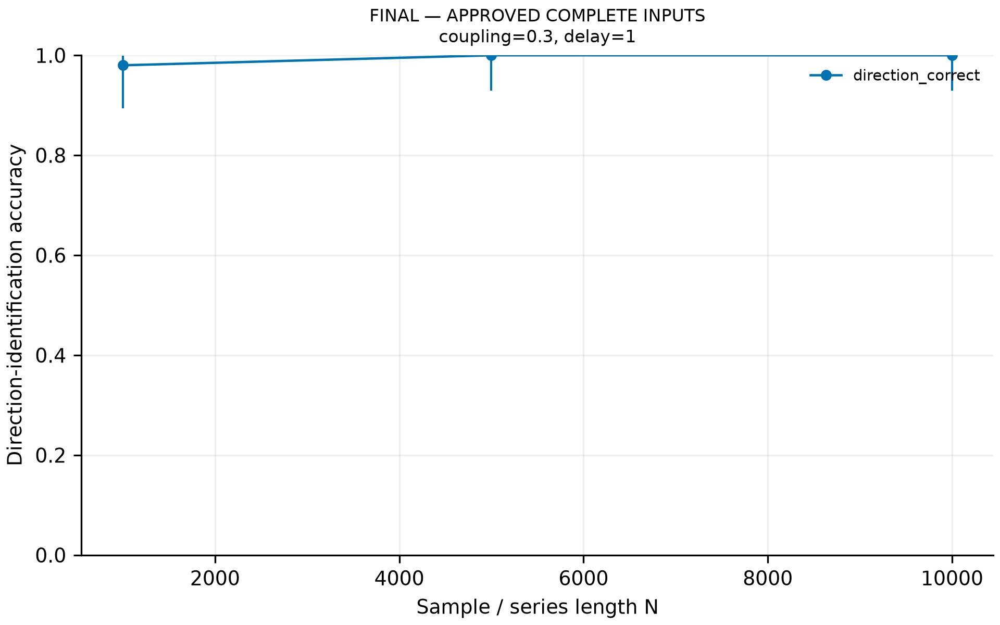

[CSV dei punti del grafico](tables/direction-correct-n--coupling-0-3--delay-1-points.csv) · [Tabella di origine](tables/accuracy.csv).

### Accuratezza del ritardo selezionato rispetto a numerosità

**accoppiamento = 0.3, ritardo fisico = 1**

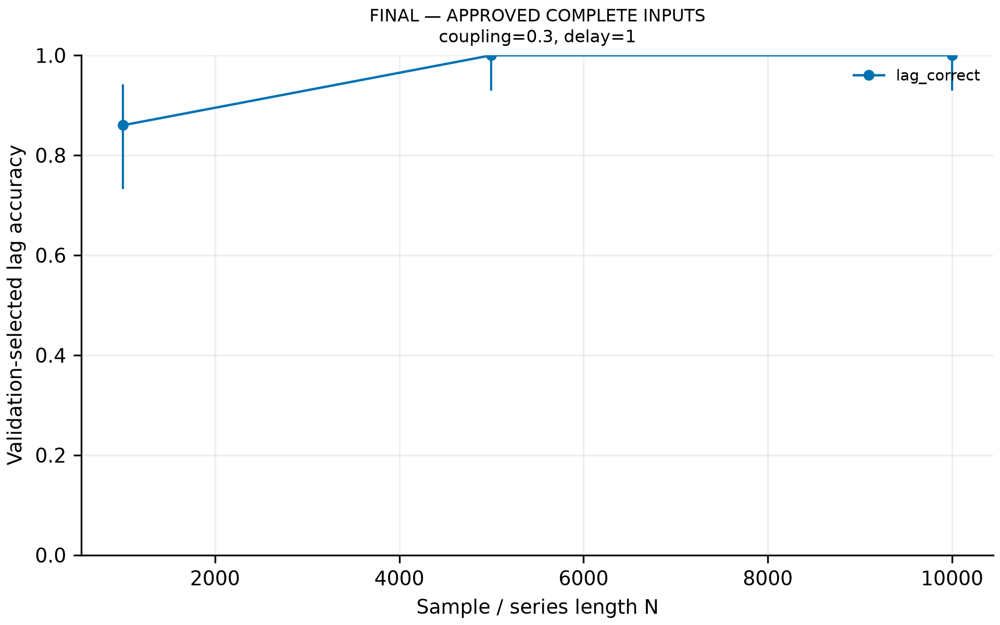

[CSV dei punti del grafico](tables/lag-correct-n--coupling-0-3--delay-1-points.csv) · [Tabella di origine](tables/accuracy.csv).

### Frequenza di falsi collegamenti rispetto a numerosità

**accoppiamento = 0.0, ritardo fisico = 1**

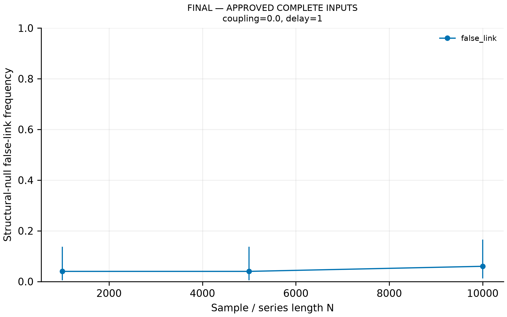

[CSV dei punti del grafico](tables/false-link-n--coupling-0-0--delay-1-points.csv) · [Tabella di origine](tables/accuracy.csv).

### TE nelle due direzioni rispetto a accoppiamento

**ritardo fisico = 1, embedding = canonical, lag = 1, n = 10000**

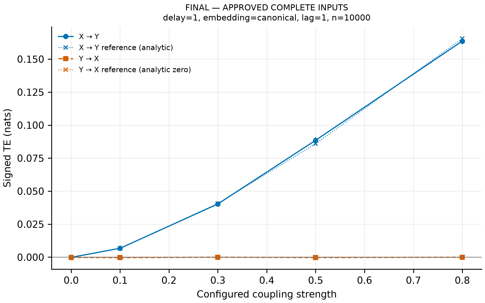

[CSV dei punti del grafico](tables/directional-te-coupling--delay-1--embedding-canonical--lag-1--n-10000-points.csv) · [Tabella di origine](tables/summaries.csv).

### Differenza di TE tra direzioni rispetto a accoppiamento

**ritardo fisico = 1, n = 10000**

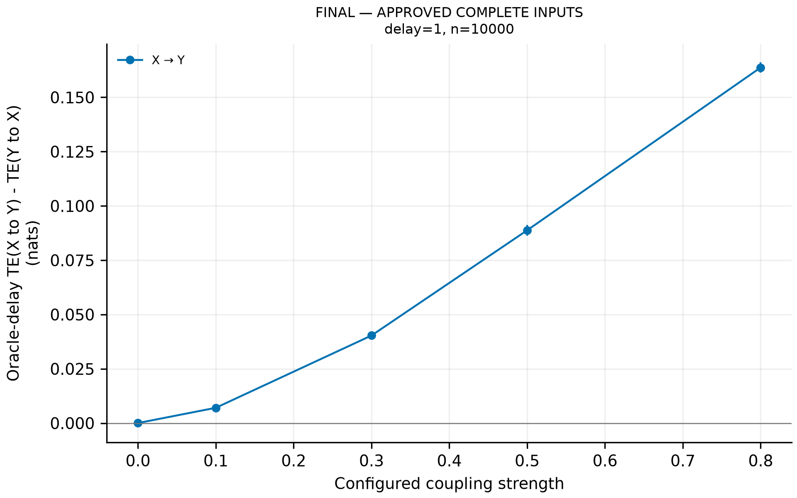

[CSV dei punti del grafico](tables/direction-difference-coupling--delay-1--n-10000-points.csv) · [Tabella di origine](tables/paired_comparisons.csv).

### Accuratezza della direzione rispetto a accoppiamento

**ritardo fisico = 1, n = 10000**

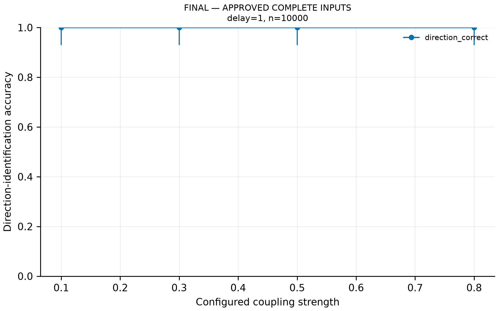

[CSV dei punti del grafico](tables/direction-correct-coupling--delay-1--n-10000-points.csv) · [Tabella di origine](tables/accuracy.csv).

### Accuratezza del ritardo selezionato rispetto a accoppiamento

**ritardo fisico = 1, n = 10000**

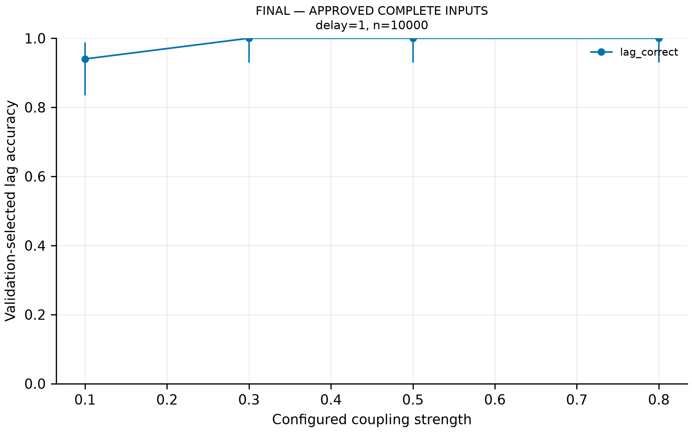

[CSV dei punti del grafico](tables/lag-correct-coupling--delay-1--n-10000-points.csv) · [Tabella di origine](tables/accuracy.csv).

### Frequenza di falsi collegamenti rispetto a accoppiamento

**ritardo fisico = 1, n = 10000**

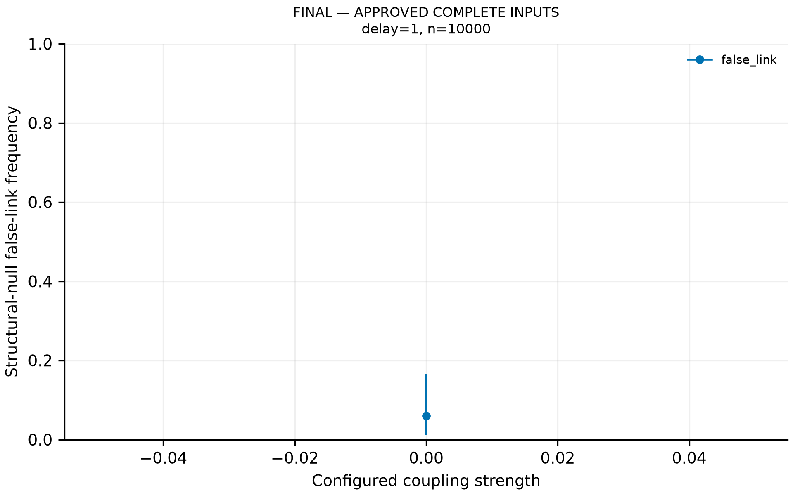

[CSV dei punti del grafico](tables/false-link-coupling--delay-1--n-10000-points.csv) · [Tabella di origine](tables/accuracy.csv).

### TE nelle due direzioni rispetto a ritardo fisico

**accoppiamento = 0.3, embedding = canonical, lag = 1, n = 10000**

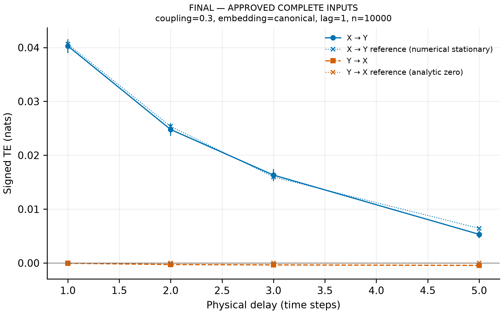

[CSV dei punti del grafico](tables/directional-te-delay--coupling-0-3--embedding-canonical--lag-1--n-10000-points.csv) · [Tabella di origine](tables/summaries.csv).

### Differenza di TE tra direzioni rispetto a ritardo fisico

**accoppiamento = 0.3, n = 10000**

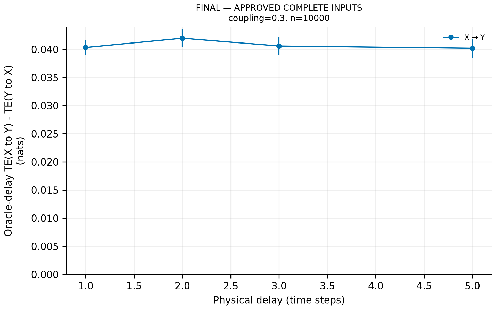

[CSV dei punti del grafico](tables/direction-difference-delay--coupling-0-3--n-10000-points.csv) · [Tabella di origine](tables/paired_comparisons.csv).

### Accuratezza della direzione rispetto a ritardo fisico

**accoppiamento = 0.3, n = 10000**

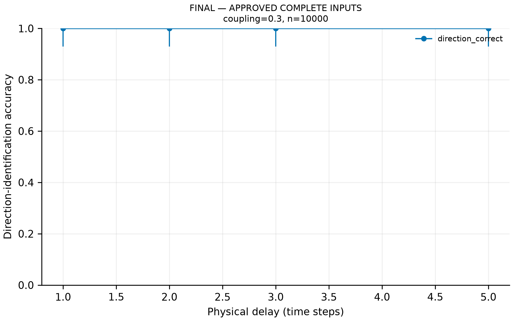

[CSV dei punti del grafico](tables/direction-correct-delay--coupling-0-3--n-10000-points.csv) · [Tabella di origine](tables/accuracy.csv).

### Accuratezza del ritardo selezionato rispetto a ritardo fisico

**accoppiamento = 0.3, n = 10000**

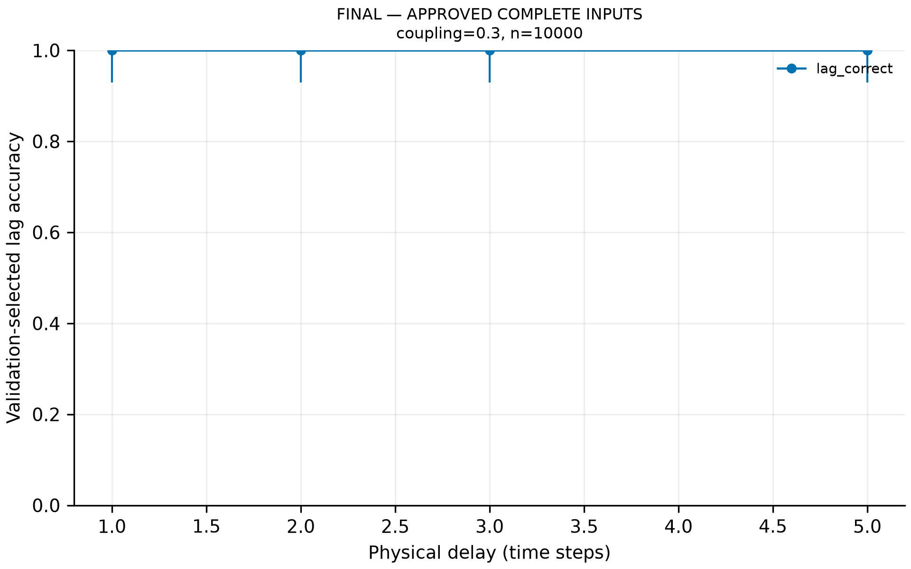

[CSV dei punti del grafico](tables/lag-correct-delay--coupling-0-3--n-10000-points.csv) · [Tabella di origine](tables/accuracy.csv).

### Frequenza di falsi collegamenti rispetto a ritardo fisico

**accoppiamento = 0.0, n = 10000**

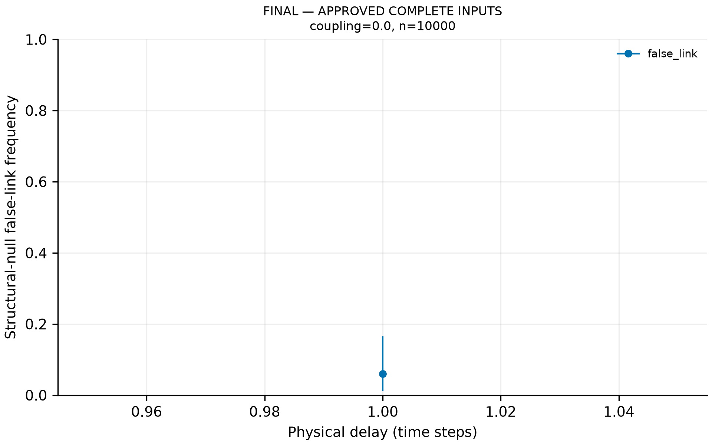

[CSV dei punti del grafico](tables/false-link-delay--coupling-0-0--n-10000-points.csv) · [Tabella di origine](tables/accuracy.csv).

### Sensibilità all’embedding

**accoppiamento = 0.3, ritardo fisico = 1, lag = 1, n = 10000**

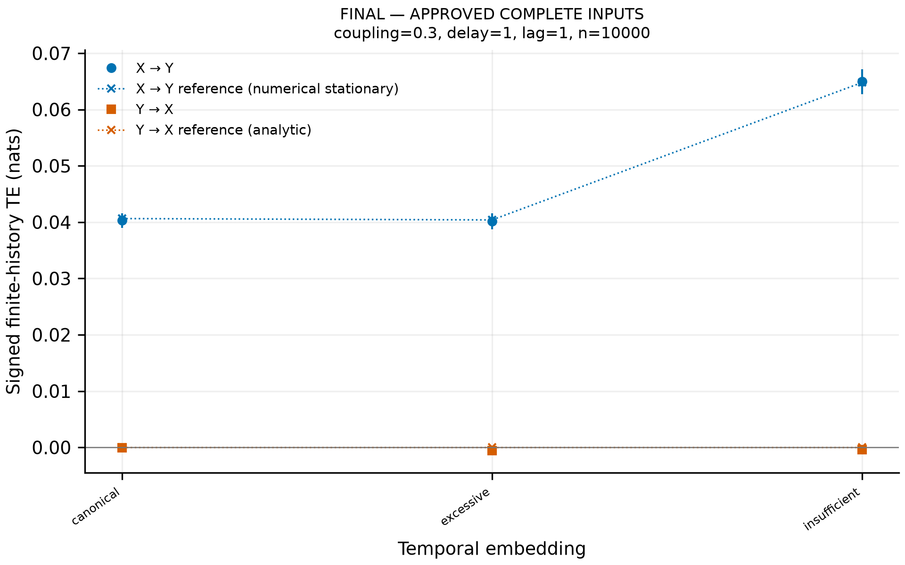

[CSV dei punti del grafico](tables/embedding-sensitivity--coupling-0-3--delay-1--lag-1--n-10000-points.csv) · [Tabella di origine](tables/summaries.csv).

### RMSE della TE a storia finita

**accoppiamento = 0.3, ritardo fisico = 1, embedding = canonical, lag = 1**

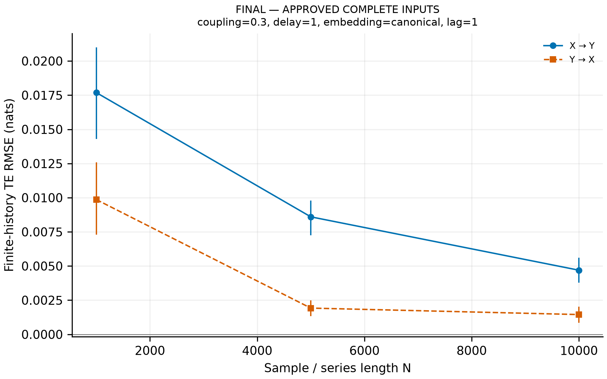

[CSV dei punti del grafico](tables/te-rmse--coupling-0-3--delay-1--embedding-canonical--lag-1-points.csv) · [Tabella di origine](tables/summaries.csv).

### Tempo medio di esecuzione

**accoppiamento = 0.3, ritardo fisico = 1, embedding = canonical, lag = 1**

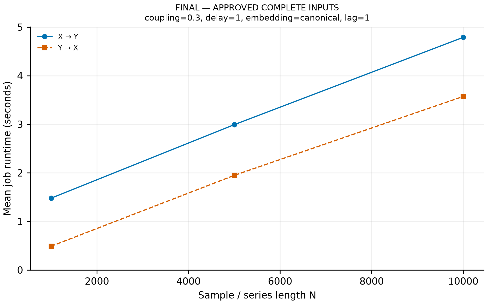

[CSV dei punti del grafico](tables/runtime--coupling-0-3--delay-1--embedding-canonical--lag-1-points.csv) · [Tabella di origine](tables/summaries.csv).

### Stato delle esecuzioni

**accoppiamento = 0.3, ritardo fisico = 1, embedding = canonical, lag = 1**

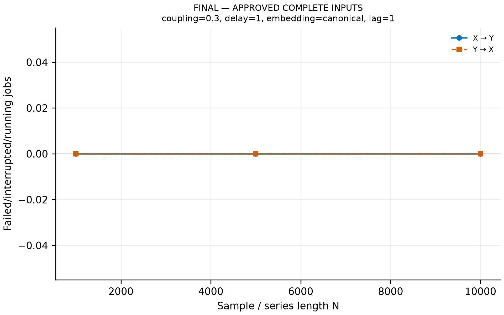

[CSV dei punti del grafico](tables/failure-counts--coupling-0-3--delay-1--embedding-canonical--lag-1-points.csv) · [Tabella di origine](tables/summaries.csv).
